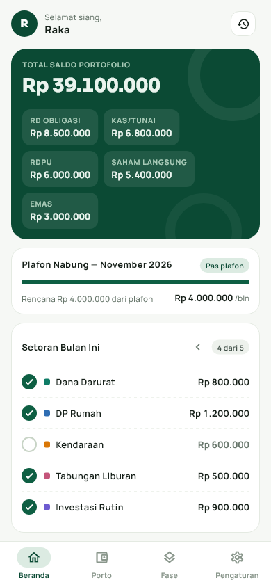
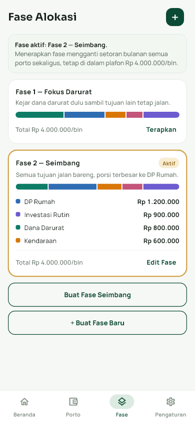
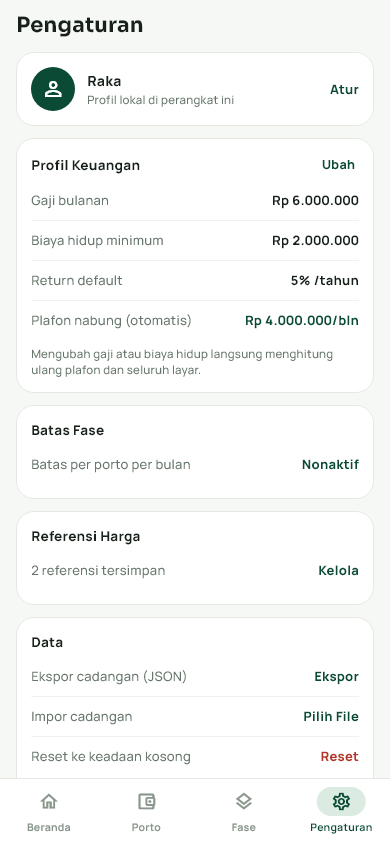

<div align="center">
  
  <h1>Planora</h1>
  <p><strong>Aplikasi Android untuk merencanakan banyak tujuan keuangan dalam satu batas nabung bulanan — rapi, praktis, dan 100% offline.</strong></p>

  <p>
    <a href="https://github.com/Dzakiamriz22/Planora/releases/latest">
      
    </a>
  </p>

  <p>
    
    
    
    
  </p>
</div>

---

## Tentang Planora

Menyiapkan dana darurat, DP rumah, kendaraan, dan tabungan jangka panjang secara bersamaan sering kali membingungkan jika hanya dicatat terpisah. Total setoran bisa tanpa sadar melewati kemampuan bulanan, sementara perkiraan waktu tercapainya tidak ikut menyesuaikan ketika nominal berubah.

**Planora** menyatukan semua rencana tersebut di satu tempat. Cukup atur penghasilan, biaya hidup, dan tujuan keuanganmu — sisanya dihitung otomatis dan tersimpan sepenuhnya di HP tanpa akun maupun internet.

### Yang Bisa Dilakukan

- **Jaga batas nabung bulanan secara otomatis** — Batas nabung dihitung dari gaji dikurangi biaya hidup minimum. Jika satu tujuan dinaikkan hingga melewati batas, Planora menampilkan pratinjau penyesuaian porsi tujuan lain terlebih dahulu sebelum disimpan.
- **Semua angka saling terhubung** — Ubah target, nominal setoran, atau catat setoran baru, maka sisa kebutuhan, progres, dan estimasi bulan tercapai langsung diperbarui.
- **Tiga jenis tujuan yang fleksibel** — *Tunai Penuh* untuk dana darurat atau liburan, *DP + Biaya* agar harga penuh tetap tercatat sementara target nabung fokus ke DP, serta *Tanpa Target* untuk tabungan atau investasi rutin.
- **Atur komposisi instrumen dengan persen** — Tentukan porsi tiap instrumen (RDPU, Obligasi, Campuran, Saham, Emas, Kas, Deposito, atau lainnya) dalam **% Persen** maupun mode bantu **Rp Nominal**, lengkap dengan slider, preset cepat (`70/30`, `60/40`, `50/50`), dan penyeimbang otomatis ke 100%.
- **Pantau progres lewat grafik yang jelas** — Dilengkapi donut alokasi (Aktual vs Target), perbandingan alokasi per instrumen, grafik pertumbuhan saldo 6/12 bulan, ringkasan setoran bulanan, status *On Track / Off Track*, insight otomatis, serta streak menabung.
- **Ubah prioritas lewat Fase** — Simpan beberapa skenario pembagian setoran bulanan (misalnya fokus dana darurat dulu, lalu geser ke DP rumah) dan ganti kapan saja tanpa mengubah tiap tujuan satu per satu.
- **Cadangan data mandiri (JSON)** — Simpan file cadangan langsung ke penyimpanan HP atau bagikan, lalu pulihkan kembali kapan dibutuhkan.

---

## Unduh & Pasang di Android

Untuk langsung mencoba di HP Android tanpa perlu instalasi alat pengembang:

1. **Unduh file APK:** [Planora-v2.2.0.apk](https://github.com/Dzakiamriz22/Planora/releases/download/v2.2.0/Planora-v2.2.0.apk) *(atau pilih versi di halaman [Releases](https://github.com/Dzakiamriz22/Planora/releases/latest))*.
2. Buka file `.apk` yang selesai diunduh di HP.
3. Jika muncul permintaan izin *Instal aplikasi dari sumber tidak dikenal*, izinkan agar pemasangan bisa dilanjutkan.
4. Saat pertama kali dibuka, Planora mulai dalam keadaan kosong (`Rp 0`) supaya kamu bisa langsung mengisi rencana sesuai kondisi sendiri.

---

## Tampilan Aplikasi

### Halaman Utama

| Beranda | Portofolio | Fase Alokasi | Pengaturan |
| :---: | :---: | :---: | :---: |
|  |  |  |  |

### Detail & Formulir

| Detail Porto | Form Porto | Form Fase |
| :---: | :---: | :---: |
|  |  |  |

<sub>*Angka pada gambar di atas hanya contoh ilustrasi. Instalasi baru selalu dimulai dari kosong tanpa data bawaan.*</sub>

---

## Teknologi

- **Flutter & Dart** — Antarmuka bersih dengan dukungan mode terang/gelap mengikuti sistem dan font lokal (Sora & Manrope) agar tetap rapi saat offline.
- **Drift (SQLite)** — Penyimpanan data lokal di perangkat.
- **Riverpod** — Pengelolaan state agar perubahan angka langsung terlihat di seluruh layar.
- **fl_chart** — Visualisasi donut, bar perbandingan, grafik pertumbuhan saldo, dan sparkline.
- **go_router** — Navigasi antar halaman dan 4 tab utama.

---

## Menjalankan dari Kode Sumber

Untuk menjalankan atau mengembangkan proyek ini secara lokal, pastikan **Flutter SDK (3.50+)**, **Java JDK 17**, dan **Android SDK** sudah terpasang.

```bash
git clone https://github.com/Dzakiamriz22/Planora.git
cd Planora
flutter pub get
flutter test
flutter run
```

---

## Privasi & Batasan

- **Sepenuhnya lokal di perangkat:** Planora tidak memiliki server, tidak memerlukan akun, tidak memuat iklan maupun pelacak, tidak meminta izin internet, dan tidak terhubung ke rekening bank atau akun investasi mana pun. Selengkapnya dapat dibaca di [PRIVACY.md](PRIVACY.md).
- **Alat bantu perencanaan:** Planora dibuat sebagai catatan dan kalkulator perencanaan pribadi, bukan penasihat keuangan. Estimasi waktu tercapai maupun simulasi cicilan bersifat ilustratif sesuai angka yang kamu masukkan.

---

## Lisensi

Dirilis di bawah lisensi [MIT](LICENSE).
