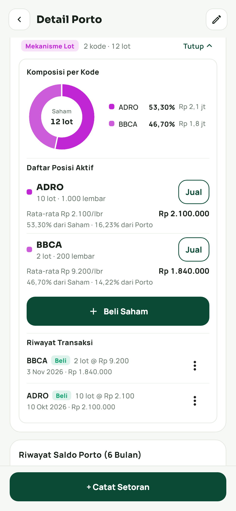
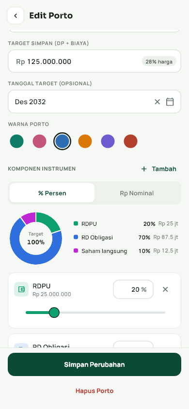

<div align="center">
  
  <h1>Planora</h1>
  <p><strong>Rencanakan. Tabung. Tercapai.</strong></p>
  <p>Aplikasi Android untuk merencanakan banyak tujuan keuangan sekaligus — simpel, otomatis hitung ulang, dan 100% offline di HP kamu.</p>

  <p>
    <a href="https://github.com/Dzakiamriz22/Planora/releases/latest">
      
    </a>
  </p>

  <p>
    
    
    
    
  </p>
</div>

---

## Kenapa Planora?

Punya banyak rencana — dana darurat, liburan, DP rumah, beli kendaraan, sampai investasi rutin — tapi semuanya datang dari satu penghasilan bulanan?

Sering kali kalau dihitung manual di catatan atau spreadsheet, total rencana nabung diam-diam melebihi kemampuan gaji, atau angka target dan estimasi waktu tercapainya jadi nggak sinkron.

**Planora** hadir buat bikin perencanaan keuangan pribadi jadi jauh lebih tenang:
- **Batas nabung bulanan otomatis terjaga** — dihitung dari penghasilan dikurangi biaya hidup minimum kamu. Kalau salah satu tujuan kamu naikkan sampai melewati batas, Planora bantu atur ulang porsi tujuan lain dengan persetujuan kamu dulu.
- **Ubah satu angka, semuanya ikut update** — ganti target, ubah setoran bulanan, atau catat setoran baru, estimasi kapan tercapai dan sisa kebutuhan langsung berubah otomatis.
- **Harga barang & target DP tidak ketukar** — untuk tujuan beli kredit (seperti rumah atau kendaraan), harga penuh tetap terlihat, tapi target nabungnya cukup sebesar DP + biaya saja.
- **Catat tempat & isi tabungan secara terpisah** — kamu tahu uangnya disimpan di mana (bank, e-wallet, aplikasi investasi, atau lainnya) dan dipecah ke instrumen apa saja (tunai, RDPU, obligasi, emas, saham, dll.).
- **Ganti prioritas lewat Fase** — mau fokus ngejar dana darurat dulu, lalu nanti geser ke DP rumah? Cukup buat fase sendiri dan ganti kapan pun tanpa repot ubah satu per satu.
- **100% lokal & tanpa akun** — mulai dari nol (kosong total), nggak perlu daftar/login, nggak butuh internet, dan data bisa kamu cadangkan sendiri kapan saja lewat file JSON.

---

## Tampilan Aplikasi

### 4 Halaman Utama

| Beranda | Portofolio | Fase Alokasi | Pengaturan |
| :---: | :---: | :---: | :---: |
|  |  |  |  |

### Detail & Formulir

| Detail Porto | Form Porto | Form Fase |
| :---: | :---: | :---: |
|  |  |  |

> *Contoh angka di screenshot di atas hanya ilustrasi tampilan. Saat pertama kali dipasang, Planora mulai dalam keadaan kosong (`Rp 0`) supaya kamu bisa mengisi rencana sesuai kondisi kamu sendiri.*

---

## Dibangun Dengan

- **Flutter & Dart** — tampilan bersih dengan font lokal `Sora` & `Manrope` (tetap tampil rapi meski tanpa internet) + dukungan mode gelap mengikuti sistem HP.
- **Drift (SQLite)** — penyimpanan lokal di HP yang cepat dan aman.
- **Riverpod** — setiap perubahan setoran, target, atau gaji langsung memperbarui semua halaman tanpa perlu refresh.
- **go_router** — navigasi 4 tab yang ringan dan rapi.

---

## Cara Coba di Komputer / HP Sendiri

Pastikan sudah memasang **Flutter SDK** (`3.50+`), **Java JDK 17**, dan **Android SDK**.

```bash
# 1. Clone repo ini
git clone https://github.com/Dzakiamriz22/Planora.git
cd Planora

# 2. Ambil semua package
flutter pub get

# 3. Jalankan tes otomatis (opsional, untuk cek semua perhitungan)
flutter test

# 4. Jalankan langsung ke HP Android yang terhubung kabel USB
flutter run
```

---

## Privasi & Catatan Penting

- **Data 100% di HP kamu:** Planora tidak punya server, tidak pakai iklan/pelacak, tidak minta izin internet, dan tidak pernah meminta login atau akses ke akun bank/investasi kamu. Selengkapnya ada di [PRIVACY.md](PRIVACY.md).
- **Catatan penting:** Planora adalah alat bantu perencanaan pribadi, bukan penasihat keuangan. Estimasi tanggal tercapai maupun simulasi cicilan hanyalah hitungan ilustrasi berdasarkan angka asumsi yang kamu masukkan sendiri.

---

## Lisensi

Proyek ini dirilis dengan lisensi [MIT](LICENSE).
