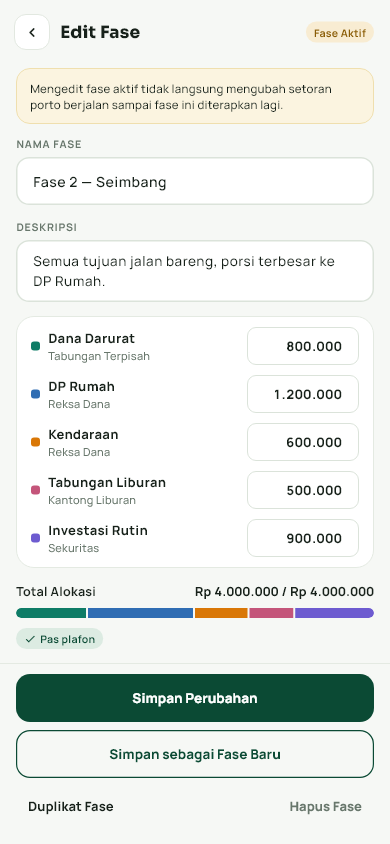

<div align="center">
  
  <h1>Planora</h1>
  <p><strong>Perencana tujuan keuangan pribadi untuk Android — ringan, terstruktur, dan sepenuhnya offline.</strong></p>

  <p>
    <a href="https://github.com/Dzakiamriz22/Planora/releases/latest">
      
    </a>
  </p>

  <p>
    
    
    
    
  </p>
</div>

---

## Ringkasan

Mengelola beberapa tujuan keuangan sekaligus — seperti dana darurat, DP rumah, kendaraan, atau tabungan jangka panjang — sering kali sulit jika hanya dicatat terpisah. Total rencana setoran bisa tanpa sadar melewati kemampuan bulanan, atau perkiraan waktu tercapai tidak ikut berubah saat nominal setoran bergeser.

**Planora** membantu merapikan seluruh rencana tersebut di satu tempat dengan perhitungan yang saling terhubung, berjalan lokal di perangkat Android tanpa memerlukan akun maupun koneksi internet.

### Fitur Utama

- **Batas nabung bulanan otomatis** — Dihitung dari penghasilan bulanan dikurangi biaya hidup minimum. Jika perubahan pada satu tujuan membuat total setoran melewati batas, Planora menampilkan pratinjau penyesuaian porsi tujuan lain terlebih dahulu sebelum disimpan.
- **Perhitungan saling terhubung** — Mengubah target, nominal setoran, atau mencatat setoran baru akan memperbarui sisa kebutuhan, persentase progres, dan estimasi bulan tercapai secara otomatis.
- **Mendukung tiga mode tujuan** — *Tunai Penuh* (dana darurat, liburan, pendidikan), *DP + Biaya* (harga penuh tetap dicatat sebagai referensi, sedangkan target menabung fokus pada DP dan biaya awal), serta *Tanpa Target* (tabungan atau investasi rutin).
- **Pencatatan tempat simpan & rincian instrumen** — Pisahkan label tempat simpan (bank, e-wallet, sekuritas, aplikasi investasi, atau teks bebas) dengan komposisi instrumen di dalamnya (Kas/Tunai, RDPU, Obligasi, Saham, Emas, Deposito, dll.).
- **Fase alokasi kustom** — Simpan beberapa skenario pembagian setoran bulanan (misalnya fokus dana darurat dulu, lalu bergeser ke DP rumah) dan terapkan kapan pun tanpa mengubah setiap portofolio satu per satu.
- **Cadangan & pemulihan data (JSON)** — Seluruh data tersimpan lokal di HP dan dapat diekspor ke file JSON (simpan langsung ke perangkat atau bagikan) lalu diimpor kembali saat dibutuhkan.

---

## Unduh & Pasang di Android

Tidak perlu kompilasi atau konfigurasi apa pun untuk mencoba aplikasi ini di HP Android:

1. **Unduh APK terbaru:** [Planora-v2.1.0.apk](https://github.com/Dzakiamriz22/Planora/releases/download/v2.1.0/Planora-v2.1.0.apk) *(atau buka halaman [Releases](https://github.com/Dzakiamriz22/Planora/releases/latest))*.
2. Buka file `.apk` yang sudah selesai diunduh di perangkat Android.
3. Jika sistem menampilkan permintaan izin *Instal aplikasi dari sumber tidak dikenal*, izinkan untuk melanjutkan pemasangan.
4. Saat pertama kali dibuka, Planora dimulai dalam keadaan kosong (`Rp 0`) agar Anda bisa langsung mengisi data sesuai kebutuhan sendiri.

---

## Tampilan Aplikasi

### Halaman Utama

| Beranda | Portofolio | Fase Alokasi | Pengaturan |
| :---: | :---: | :---: | :---: |
|  |  |  |  |

### Detail & Formulir

| Detail Porto | Form Porto | Form Fase |
| :---: | :---: | :---: |
|  |  |  |

<sub>*Angka pada tangkapan layar di atas hanyalah contoh ilustrasi. Instalasi baru selalu dimulai dalam kondisi kosong tanpa data bawaan.*</sub>

---

## Teknologi

- **Flutter & Dart** — Antarmuka bersih dengan dukungan mode terang/gelap mengikuti sistem dan font lokal (Sora & Manrope) agar tetap konsisten saat offline.
- **Drift (SQLite)** — Penyimpanan data relasional lokal di perangkat.
- **Riverpod** — Pengelolaan state agar perubahan angka langsung tercermin di seluruh layar.
- **go_router** — Navigasi antar halaman dan 4 tab utama.

---

## Menjalankan dari Kode Sumber

Untuk pengembang yang ingin menjalankan atau memodifikasi proyek secara lokal, pastikan **Flutter SDK (3.50+)**, **Java JDK 17**, dan **Android SDK** sudah terpasang.

```bash
# 1. Clone repositori
git clone https://github.com/Dzakiamriz22/Planora.git
cd Planora

# 2. Pasang dependensi
flutter pub get

# 3. Jalankan pengujian otomatis (opsional)
flutter test

# 4. Jalankan di perangkat Android yang terhubung
flutter run
```

---

## Privasi & Batasan

- **Penyimpanan lokal sepenuhnya:** Planora tidak menggunakan server, tidak memerlukan akun/login, tidak memuat iklan atau pelacak, tidak meminta izin internet, dan tidak terhubung ke rekening bank atau akun investasi mana pun. Detail kebijakan privasi tersedia di [PRIVACY.md](PRIVACY.md).
- **Alat bantu pencatatan:** Planora dibuat sebagai alat bantu perencanaan pribadi, bukan penasihat keuangan. Estimasi waktu tercapai maupun simulasi cicilan bersifat ilustratif berdasarkan angka asumsi yang Anda masukkan sendiri.

---

## Lisensi

Dirilis di bawah lisensi [MIT](LICENSE).
