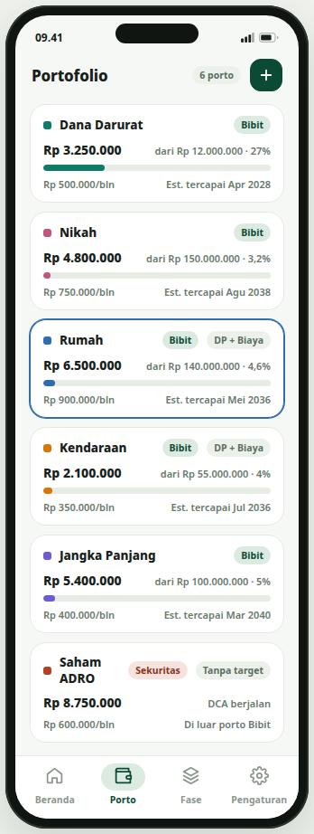
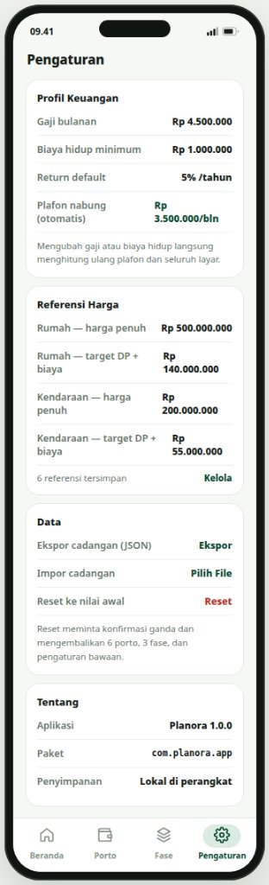

<div align="center">
  
  <h1>Planora</h1>
  <p><strong>Rencanakan. Tabung. Tercapai.</strong></p>
  <p>Aplikasi perencanaan keuangan pribadi multi-tujuan berbasis Android — reaktif, berplafon keras, 100% offline, dan siap cloud.</p>

  <p>
    
    
    
    
    
    
  </p>
</div>

---

## Tentang Planora

**Planora** membantu Anda merencanakan beberapa tujuan keuangan sekaligus — dana darurat, pernikahan, uang muka rumah, kendaraan, pendidikan, hingga investasi jangka panjang — dalam satu tempat dengan satu aturan yang selalu dijaga sistem:

> **Total rencana setoran bulanan tidak pernah melebihi kapasitas menabung Anda (plafon = penghasilan − biaya hidup minimum).**

Aplikasi mulai dalam keadaan **kosong total** tanpa data contoh pribadi siapa pun, tanpa pendaftaran akun, tanpa izin internet, dan dapat dikustomisasi penuh dari nol.

### Fitur Utama

- **Plafon Keras & Penyeimbangan Proporsional** — Setiap perubahan rencana setoran divalidasi di lapisan repository. Jika melewati plafon, Planora menampilkan dialog pratinjau penyeimbangan proporsional (angka lama vs baru) yang hanya disimpan atas persetujuan eksplisit.
- **Mesin Perhitungan Reaktif Dua Arah** — Pilih mode **Setoran ikut target** (tanggal tetap, setoran dihitung ulang dengan return majemuk) atau **Tanggal ikut setoran** (setoran tetap, simulasi estimasi tanggal tercapai hingga 600 bulan).
- **Pemisahan Platform vs Instrumen** — Catat *di mana* dana disimpan (preset generik tanpa merek + teks bebas) secara terpisah dari *isi instrumennya* (komponen multi-baris per porto dengan penjaga `total komponen ≤ saldo`).
- **Harga Penuh vs DP + Biaya** — Untuk pembelian kredit, harga penuh tetap ditampilkan sebagai konteks sementara target tabungan hanya menghitung DP + biaya, lengkap dengan ilustrasi cicilan anuitas.
- **Fase Alokasi Kustom Penuh** — Buat, edit, duplikat, simpan sebagai fase baru, urutkan, dan terapkan templat pembagian setoran bulanan, termasuk pembuat **Fase Seimbang** otomatis dan batas per porto opsional.
- **Catatan Setoran, Checklist Bulanan, & Riwayat Global** — Saldo porto selalu diturunkan dari catatan setoran; checklist bulan berjalan tercentang otomatis tanpa tombol manual terpisah.
- **Cadangan JSON Portabel & Privasi Penuh** — Ekspor/impor JSON `schema_version: 2` (kompatibel mundur dengan `v1`), reset konfirmasi ganda, `allowBackup="false"`, dan tanpa izin jaringan.

---

## Tampilan Aplikasi

### Halaman Utama (4 Tab Navigasi)

| Beranda | Portofolio | Fase Alokasi | Pengaturan |
| :---: | :---: | :---: | :---: |
|  |  |  |  |

### Halaman Detail & Formulir

| Detail Porto | Form Porto | Form Fase (Kustom Penuh) |
| :---: | :---: | :---: |
|  |  |  |

> *Catatan: Angka pada tangkapan layar di atas adalah ilustrasi desain UI. Saat instalasi baru, Planora mulai dalam keadaan kosong total (`Rp 0`) agar Anda dapat mengisi tujuan dan profil Anda sendiri.*

---

## Arsitektur & Teknologi

| Lapisan | Teknologi | Peran |
| --- | --- | --- |
| **UI & Navigasi** | Flutter, `go_router` (`StatefulShellRoute`) | 4 tab utama + layar detail/form di luar shell, tema terpusat (`Sora`, `Manrope`, `JetBrains Mono` lokal) |
| **State Management** | `flutter_riverpod` | Provider reaktif yang membaca stream Drift dan mesin hitung |
| **Mesin Perhitungan** | Dart murni (`lib/core/calc/`) | Bebas dependensi Flutter; seluruh rumus finansial & validasi diuji unit |
| **Database Lokal** | `drift` (SQLite) | 8 tabel cloud-ready ber-UUID (`user_profiles`, `settings`, `portfolios`, `portfolio_components`, `contributions`, `phases`, `phase_allocations`, `price_references`) dengan migrasi skema berversi |
| **Format & Berkas** | `intl` (`id_ID`), `file_picker`, `share_plus` | Format Rupiah penuh tanpa desimal & ekspor/impor JSON lokal |

### Struktur Proyek

```text
lib/
├── main.dart                    # Inisialisasi locale id_ID & DB lokal
├── app.dart                     # Router 4 tab + tema terang/gelap sistem
├── core/
│   ├── calc/                    # Mesin perhitungan murni Dart (tanpa Flutter)
│   ├── constants/               # Preset platform & instrumen generik
│   ├── format/                  # Formatter Rupiah & tanggal id_ID
│   └── theme/                   # Token warna PlanoraColors & AppTheme
├── data/
│   ├── db/                      # 8 tabel Drift, migrasi v1→v2, seed kosong v3
│   └── repositories/            # Profile, Portfolio, Phase, & Settings repository
├── features/
│   ├── splash/                  # Splash animasi 2,4 detik
│   ├── onboarding/              # Onboarding 4 langkah (dapat dilewati)
│   ├── profile/                 # Profil pengguna lokal & foto lokal
│   ├── home/                    # Beranda & checklist setoran bulanan
│   ├── portfolios/              # Daftar, detail, komponen, form, & riwayat global
│   ├── phases/                  # Fase alokasi & form fase kustom penuh
│   └── settings/                # Profil keuangan, batas fase, referensi, ekspor/impor
└── widgets/                     # Komponen UI bersama, logo vektor, & dialog
test/
├── calc/                        # 10 skenario uji angka + kasus tepi
└── db/                          # Uji instal kosong, repository, komponen, & JSON v2/v1
```

---

## Cara Menjalankan & Build

### Prasyarat
- **Flutter SDK** `3.50+` (Dart `3.14+`)
- **Java JDK 17** & **Android SDK** (bisa dengan Android Studio atau Android Command-line Tools saja)

### Langkah Cepat

```bash
# 1. Clone repositori
git clone https://github.com/Dzakiamriz22/Planora.git
cd Planora

# 2. Pasang dependensi
flutter pub get

# 3. Hasilkan kode Drift (jika memodifikasi tabel)
dart run build_runner build

# 4. Jalankan analisis statis & seluruh unit/repository test
flutter analyze
flutter test

# 5. Build APK rilis (untuk instal langsung di HP Android)
flutter build apk --release

# 6. Build App Bundle rilis (untuk Google Play Store)
flutter build appbundle --release
```

File hasil build berada di:
- APK: `build/app/outputs/flutter-apk/app-release.apk`
- AAB: `build/app/outputs/bundle/release/app-release.aab`

---

## Privasi & Penafian

- **Privasi:** Seluruh data disimpan 100% lokal di perangkat Anda. Planora tidak memerlukan akun, tidak memiliki izin internet, tidak memuat SDK analitik/iklan, dan tidak pernah meminta kredensial platform keuangan mana pun. Baca rinciannya di [PRIVACY.md](PRIVACY.md).
- **Penafian:** Planora adalah alat bantu perencanaan keuangan pribadi, bukan penasihat keuangan berlisensi. Setiap proyeksi estimasi tanggal tercapai, perlu setoran per bulan, dan ilustrasi cicilan dihitung berdasarkan asumsi yang Anda masukkan sendiri, bukan janji hasil investasi atau penawaran kredit.

---

## Lisensi

Dirilis di bawah lisensi [MIT](LICENSE).
