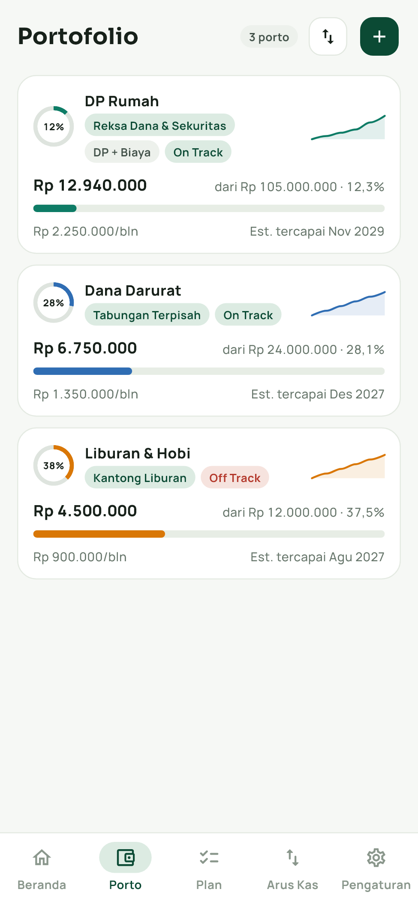
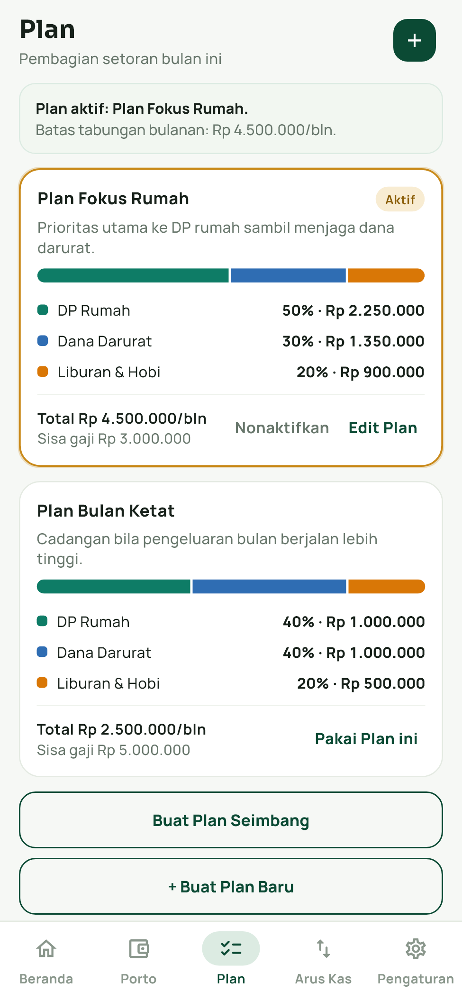
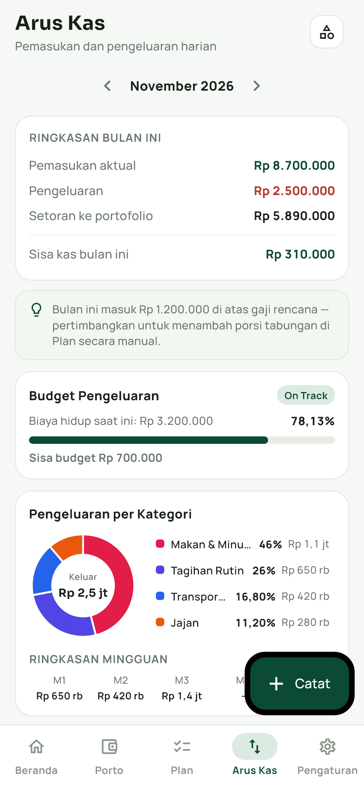
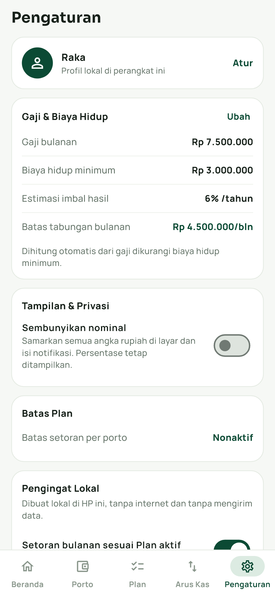
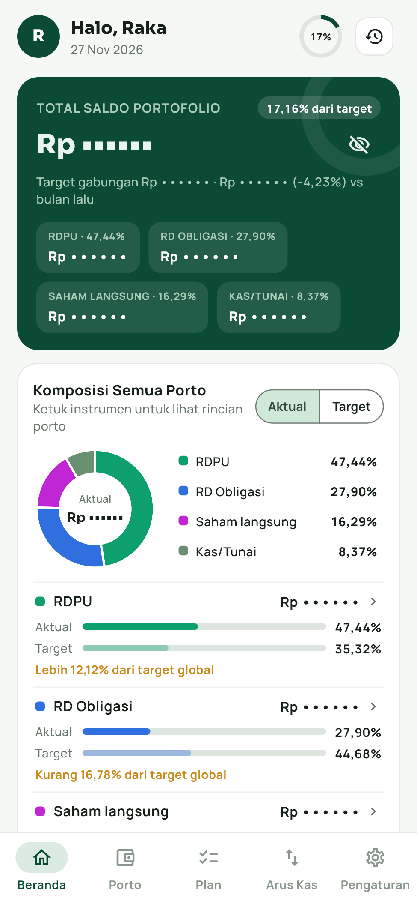
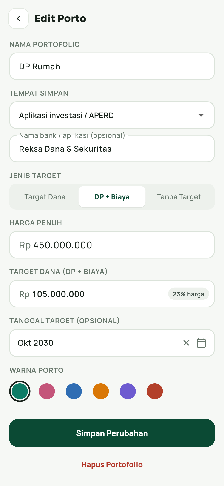
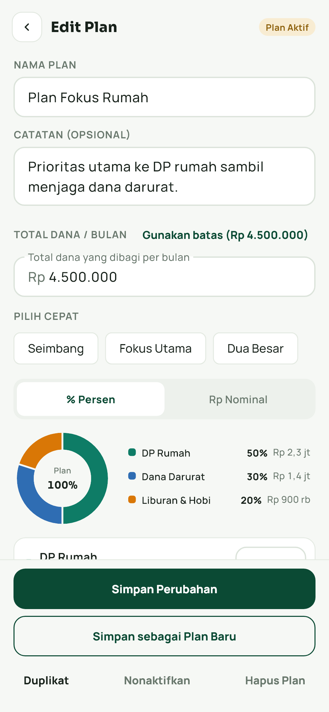

<div align="center">
  
  <h1>Planora</h1>
  <p><strong>Aplikasi Android untuk merencanakan banyak tujuan keuangan, memantau komposisi aset, dan mencatat arus kas harian dalam satu tempat — rapi, praktis, dan 100% offline.</strong></p>

  <p>
    <a href="https://github.com/Dzakiamriz22/Planora/releases/latest">
      
    </a>
  </p>

  <p>
    
    
    
    
    
  </p>
</div>

---

## Tentang Planora

Menyiapkan dana darurat, DP rumah, kendaraan, dan tabungan jangka panjang sekaligus mengatur arus kas bulanan sering membingungkan jika dicatat terpisah. Total setoran bisa tanpa sadar melewati kemampuan bulanan, komposisi aset tidak terlihat menyeluruh, dan sisa kas bulanan sulit dipantau.

**Planora** menyatukan perencanaan portofolio, pembagian setoran bulanan (**Plan**), dan catatan **Arus Kas** (pemasukan & pengeluaran) di satu aplikasi. Semua perhitungan berjalan otomatis dan seluruh data tersimpan lokal di HP tanpa akun maupun izin internet.

### Fitur Utama

- **Batas Tabungan Bulanan & Rebalance Otomatis** — Dihitung dari gaji dikurangi biaya hidup minimum. Jika total rencana setoran melewati batas, Planora menampilkan pratinjau penyesuaian proporsional sebelum disimpan.
- **Plan Berbasis Persentase & Nominal Tepat** — Bagi dana tabungan bulanan ke tiap portofolio lewat mode **% Persen** (slider, donut live, preset cepat, simpan draf) atau **Rp Nominal** yang tersimpan persis tanpa bergeser akibat pembulatan. Plan aktif otomatis memperbarui setoran bulanan tiap portofolio dan dapat dinonaktifkan kapan saja.
- **Komposisi Instrumen Per Porto & Global** — Atur porsi instrumen (RDPU, Obligasi, Campuran, RD Saham, Emas, Kas, Deposito, atau custom) per portofolio, lalu pantau agregasi seluruh aset lewat kartu **Komposisi Semua Porto** (persen aktual global, target global tertimbang, serta rincian per portofolio).
- **Saham Langsung Berbasis Lot (`1 lot = 100 lembar`)** — Catat beli/jual saham langsung berdasarkan kode saham, jumlah lot, dan harga per lembar dengan perhitungan harga rata-rata (average cost), total modal, dan riwayat transaksi lengkap.
- **Arus Kas (Pemasukan + Pengeluaran)** — Catat pemasukan dan pengeluaran harian dalam ≤ 3 ketukan dengan kategori terpisah per jenis (5 kategori pemasukan + 10 kategori pengeluaran bawaan + kategori custom). Pantau **Sisa Kas Bulan Ini** (`Pemasukan aktual − Pengeluaran − Setoran ke portofolio`), budget pengeluaran (On Track / Hati-hati / Over Budget), donut kategori, ringkasan mingguan, dan grafik 6 bulan vs budget.
- **Mode Privasi (Sembunyikan Nominal)** — Ketuk ikon mata di Beranda atau saklar di Pengaturan untuk menyamarkan seluruh angka rupiah (`Rp ••••••`) di layar, grafik, hingga isi notifikasi — sementara persentase, progress bar, dan status tetap dapat dibaca.
- **Pengingat Lokal Offline** — Pengingat setoran bulanan sesuai Plan aktif, pengingat catat arus kas harian, dan notifikasi milestone portofolio (`25/50/75/100%`) langsung di perangkat tanpa server.
- **Cadangan Data Mandiri (JSON)** — Ekspor dan pulihkan seluruh data (termasuk Arus Kas, Saham, dan Plan) lewat file JSON lokal dengan kompatibilitas lintas versi.

---

## Preview Aplikasi

### 5 Tab Utama

| Beranda | Portofolio | Plan | Arus Kas | Pengaturan |
| :---: | :---: | :---: | :---: | :---: |
|  |  |  |  |  |

### Mode Privasi, Detail Portofolio & Formulir

| Mode Privasi (Beranda) | Detail Porto & Saham Lot | Form Portofolio | Form Plan |
| :---: | :---: | :---: | :---: |
|  |  |  |  |

<sub>*Angka, transaksi, dan kode saham pada gambar di atas hanya contoh ilustrasi. Instalasi baru selalu dimulai dari keadaan kosong (`Rp 0`).*</sub>

---

## Unduh & Pasang di Android

1. **Unduh APK terbaru:** [Planora-v3.3.0.apk](https://github.com/Dzakiamriz22/Planora/releases/download/v3.3.0/Planora-v3.3.0.apk) *(atau pilih rilis di halaman [Releases](https://github.com/Dzakiamriz22/Planora/releases/latest))*.
2. Buka file `.apk` di HP Android kamu lalu pilih **Instal / Update** *(data dari versi lama otomatis termigrasi aman)*.
3. Jika diminta izin *Instal aplikasi dari sumber tidak dikenal*, izinkan untuk melanjutkan pemasangan.

---

## Teknologi & Dokumentasi

- **Flutter & Dart** — Antarmuka adaptif mode terang/gelap, logo vektor **Tangga Tujuan**, dan font lokal (`Sora`, `Manrope`, `JetBrains Mono`) agar tetap tajam saat offline.
- **Drift (SQLite, skema v6)** — 11 tabel lokal dengan migrasi bertahap yang teruji dan terverifikasi.
- **Riverpod** — State management reaktif untuk sinkronisasi langsung antar layar.
- **fl_chart** — Donut alokasi, bar perbandingan Aktual vs Target, grafik pertumbuhan saldo 6/12 bulan, stacked bar setoran, sparkline, dan grafik pengeluaran 6 bulan vs budget.
- **flutter_local_notifications** — Pengingat lokal di perangkat dengan izin minimal (`POST_NOTIFICATIONS` & `RECEIVE_BOOT_COMPLETED`).
- **go_router** — Navigasi 5 tab utama (`StatefulShellRoute.indexedStack`) dan rute detail/formulir.

Dokumentasi tambahan:
- [Arsitektur & Skema Database](docs/ARCHITECTURE.md)
- [Kebijakan Privasi](PRIVACY.md)

---

## Menjalankan dari Kode Sumber

Pastikan **Flutter SDK (3.50+)**, **Java JDK 17**, dan **Android SDK** sudah terpasang.

```bash
git clone https://github.com/Dzakiamriz22/Planora.git
cd Planora
flutter pub get
flutter analyze
flutter test
flutter run
```

---

## Privasi & Batasan

- **100% offline & lokal:** Tanpa server, tanpa akun, tanpa iklan/pelacak, **tanpa izin internet**, tanpa izin penyimpanan, dan tidak terhubung ke rekening bank atau sekuritas mana pun.
- **Bukan penasihat keuangan:** Estimasi waktu tercapai, proyeksi, dan simulasi cicilan bersifat ilustratif berdasarkan angka yang kamu masukkan sendiri.

---

## Lisensi

Dirilis di bawah lisensi [MIT](LICENSE).
